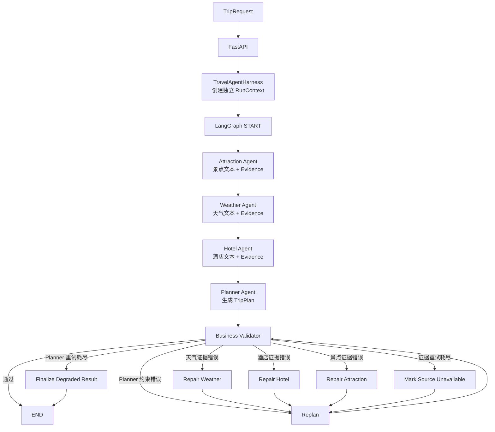

# TravelAgent：可校验、可修复、可观测的多智能体旅行规划系统

TravelAgent 是一个面向旅行规划场景的 Agent 工程实践项目。系统使用 LangGraph 编排景点、天气、酒店和行程规划四个 Agent，通过高德地图 MCP 获取外部信息，再由确定性的业务校验器检查结果，并在失败时执行定向修复、重新规划或降级返回。

项目的重点不只是“让模型生成一份行程”，而是展示如何把 Agent 做成一个具有状态管理、工具权限、调用预算、执行轨迹和离线回归能力的应用。

## 核心能力

| 能力 | 实现 |
| --- | --- |
| 多 Agent 协作 | LangGraph 串行调度 Attraction、Weather、Hotel、Planner Agent，并共享类型化状态 |
| 真实工具接入 | 通过 `langchain-mcp-adapters` 连接高德地图 MCP，使用 Streamable HTTP 传输 |
| 结构化证据 | Research Agent 同时产出 Planner 可读文本和 Validator 可检查的 Evidence |
| 业务校验 | 纯 Python Validator 检查日期、天数、景点、餐食、酒店、天气覆盖和预算 |
| 自修复与降级 | 按错误来源执行 Repair / Replan，限制重试次数，耗尽后移除不可验证事实并降级返回 |
| Agent Harness | 工具白名单、单 Agent/单请求调用预算、请求级隔离、JSONL Trace 和运行摘要 |
| 离线评测 | Fake Agent / Fake Tool 驱动的测试与 9 Case 回归评测，明确禁止访问网络和真实 MCP |

> 外部工具能够降低事实性错误，但不能保证结果绝对正确。天气预报受高德接口的预报窗口限制，酒店价格、评分和开放信息也应在出行前再次确认。

## 系统架构



正常路径仍然是清晰的串行链路：

```text
START → Attraction → Weather → Hotel → Planner → Validator → END
```

只有校验失败时才进入条件分支。LangGraph 管理的是整个业务工作流；每个 Research Agent 内部仍由 LangChain 执行 `LLM → Tool Call → MCP Tool → ToolMessage → LLM` 的工具调用循环。

## 一次请求如何运行

1. FastAPI 使用 `TripRequest` 校验输入，避免把任意字典直接传入工作流。
2. Harness 为这次请求创建独立 `RunContext`，生成 `run_id` 并初始化计数器。
3. LangGraph 将同一个 `request` 和各节点的增量结果保存在 `TripPlannerState` 中。
4. Attraction、Weather、Hotel Agent 依次查询高德 MCP，并输出结构化 Evidence。
5. Planner 汇总用户请求和三类研究结果，生成符合 `TripPlan` Schema 的 JSON。
6. Validator 用确定性 Python 规则校验结果，并将问题标记为 `planner`、`weather`、`hotel` 或 `attraction`。
7. Router 根据错误来源和重试计数选择 Repair、Replan、Degrade、Finalize 或 END。
8. Harness 写入脱敏 JSONL Trace，生成本次请求的调用次数、延迟和最终状态摘要。

## Agent 与工具权限

工具先按角色过滤，再由 `GuardedTool` 在真实 MCP 调用发生前检查权限和预算。

| Agent | 可见 MCP Tool | 单次 Run 上限 |
| --- | --- | ---: |
| Weather | `maps_weather` | 2 |
| Attraction | `maps_text_search`、`maps_search_detail`、`maps_around_search` | 2 |
| Hotel | `maps_text_search`、`maps_search_detail`、`maps_around_search` | 2 |
| Planner | 无 | 0 |
| 整个 Run | 上述允许工具 | 10 |

如果调用不合规，Harness 会在副作用发生前抛出 `ToolPolicyError`，因此请求不会到达高德 MCP；错误会作为工具错误回到 Agent 的调用链，由 Agent 决定是否改用允许的工具或结束当前任务。

## 技术栈

- Python 3.12
- FastAPI、Uvicorn、Pydantic v2
- LangChain、LangGraph、langchain-mcp-adapters
- 高德地图 MCP Server（Streamable HTTP）
- 阿里云百炼 OpenAI 兼容接口（默认模型 `deepseek-v4.1-flash`，可通过环境变量替换）
- 原生 HTML / JavaScript 前端

## 快速开始

### 1. 获取密钥

- 在[阿里云百炼 API Key 页面](https://bailian.console.aliyun.com/cn-beijing/model/settings/api-key)创建 API Key，并确认所选模型在账号所在地域可用。
- 在[高德开放平台](https://lbs.amap.com/dev/key/app)创建 Web 服务 Key。

免费额度、可用模型和计费规则由平台账号与活动决定，本仓库不保证接口永久免费。建议在控制台开启额度提醒或免费额度用完即停。

### 2. 安装依赖

```bash
git clone https://github.com/lww45217-netizen/TravelAgent.git
cd TravelAgent

python3.12 -m venv .venv
source .venv/bin/activate
python -m pip install -r requirements.txt
```

也可以使用 `uv`：

```bash
uv venv --python python3.12 .venv
source .venv/bin/activate
uv pip install -r requirements.txt
```

### 3. 配置环境变量

```bash
cp .env.example .env
```

编辑 `.env`：

```dotenv
DASHSCOPE_API_KEY=your-dashscope-api-key
DASHSCOPE_API_URL=https://dashscope.aliyuncs.com/compatible-mode/v1
DASHSCOPE_MODEL=deepseek-v4.1-flash
AMAP_API_KEY=your-amap-web-service-key
```

`.env` 已被 Git 忽略。不要把真实 Key 写入 README、测试代码、截图或提交历史。

### 4. 启动服务

启动后端：

```bash
python -m uvicorn trip_planner.main:app --reload --host 127.0.0.1 --port 8000
```

另开一个终端启动静态前端：

```bash
python -m http.server 5500 --directory trip_planner --bind 127.0.0.1
```

- 前端：<http://127.0.0.1:5500>
- Swagger：<http://127.0.0.1:8000/docs>
- 健康检查：<http://127.0.0.1:8000/>

## API 示例

```bash
curl -X POST http://127.0.0.1:8000/api/v1/trip/plan \
  -H 'Content-Type: application/json' \
  -d '{
    "city": "哈尔滨",
    "start_date": "2026-10-03",
    "end_date": "2026-10-04",
    "travel_days": 2,
    "transportation": "公共交通",
    "accommodation": "经济型酒店",
    "preferences": ["历史文化", "美食"],
    "free_text_input": "路线尽量紧凑"
  }'
```

成功时返回 `TripPlanResponse`，其中 `data` 是结构化 `TripPlan`。`validation_status` 保留在内部状态和 Trace 中，当前公开 API 为兼容前端不单独返回该字段。

## 测试与离线评测

运行全部测试：

```bash
python -m unittest discover -s tests -v
```

运行 9 Case 离线回归评测：

```bash
python -m eval.run_offline_eval
```

测试和评测使用 Fake Agent、Fake Tool 与构造的 `TripPlan`，并显式拦截网络连接、真实 MCP 初始化和真实 Agent 创建，因此不会消耗百炼或高德额度。

离线评测覆盖：正常工作流、工具放行、越权拦截、角色预算、总预算、Trace 完整性、Summary 一致性、V2 修复回归和并发请求隔离。

如需验证真实 MCP 链路，在配置有效 Key 后运行：

```bash
python -m trip_planner.trip_planner_agent
```

该命令会真实调用 LLM 和高德 MCP，可能消耗免费额度或产生费用。

## 可观测性

每次真实工作流会生成独立日志：

```text
logs/runs/trip_<uuid>.jsonl
```

Trace 记录 `run_start`、`node_start/end`、`llm_call_start/end`、`tool_call_start/end`、`validation_result`、`route`、`repair`、`replan`、`run_end` 和 `run_summary`。敏感字段按字段名脱敏，Prompt、Response、Authorization 和 API Key 不写入 Trace。

`RunSummary` 包含总延迟、工具调用次数、各 Agent 调用次数、真实模型调用次数、修复/重规划次数和最终状态。当前摘要打印在服务端并写入 Trace，不作为公开 API 字段返回。

## 项目结构

```text
TravelAgent/
├── eval/
│   ├── cases/fakes.py              # Fake Agent / Fake Tool / 测试数据
│   └── run_offline_eval.py         # 9 Case 回归评测
├── tests/                          # 工作流、策略、Trace、Summary 测试
├── trip_planner/
│   ├── harness/
│   │   ├── core.py                 # Policy、RunContext、Metrics、生命周期
│   │   ├── tool_guard.py           # Tool 过滤与调用前拦截
│   │   └── tracing.py              # JSONL Trace
│   ├── evidence.py                 # Agent 文本到 Evidence 的解析
│   ├── main.py                     # FastAPI 入口
│   ├── prompts.py                  # 四个 Agent 的系统提示词
│   ├── schemas.py                  # 输入、输出、Evidence Schema
│   ├── trip_planner_agent.py       # Agent 初始化与 LangGraph 编排
│   ├── validation.py               # 确定性业务校验与修复
│   └── index.html                  # 静态前端
├── .env.example                    # 环境变量模板
├── env_utils.py                    # 环境变量加载
├── my_llm.py                       # 百炼兼容模型初始化
└── requirements.txt
```

## 当前边界

- 三个 Research 节点为串行执行，优点是流程直观、Trace 易读；若追求低延迟，可改为 LangGraph 并行分支后汇合。
- 天气只能使用接口当前可返回的预报范围，远期旅行会进入修复或降级路径。
- 酒店价格和评分来自搜索结果，不能替代预订平台的实时库存与最终价格。
- Trace 当前写本地 JSONL，尚未接入数据库、OpenTelemetry 或可视化监控平台。
- FastAPI 当前统一返回 HTTP 200，并通过 `success` 表达业务失败；生产环境可进一步映射标准 HTTP 错误码。

## License

[MIT License](LICENSE)
